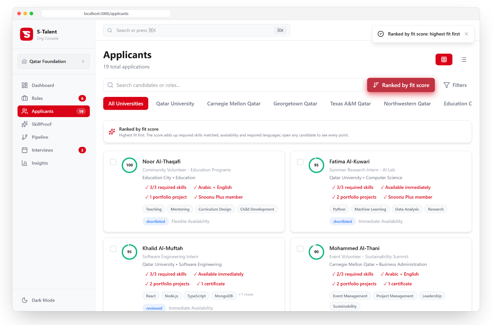
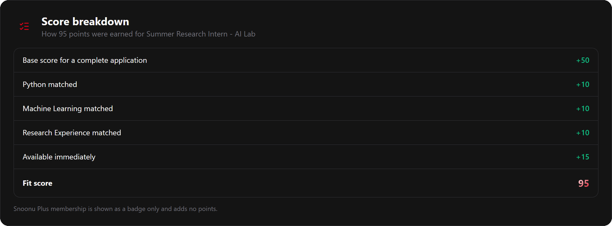
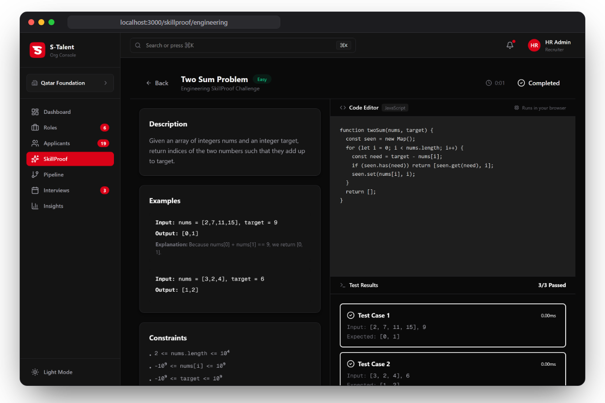
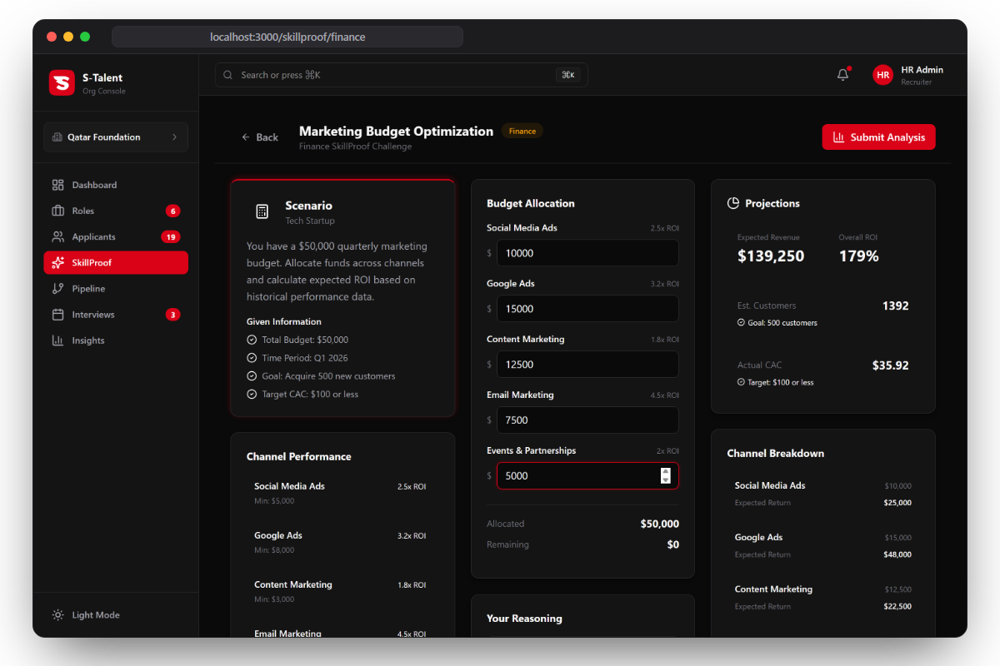
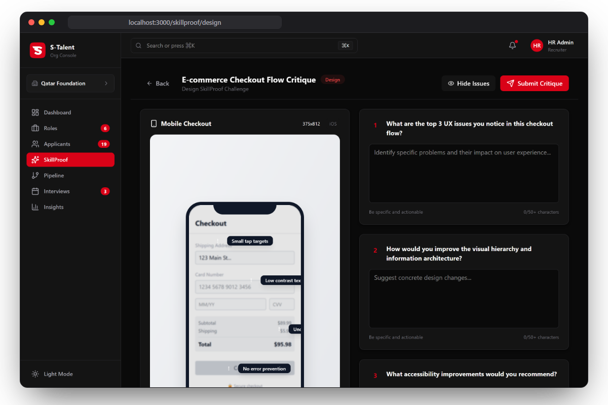
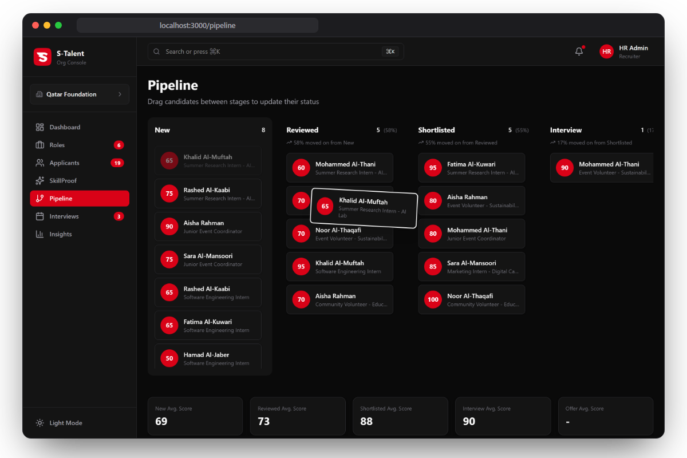
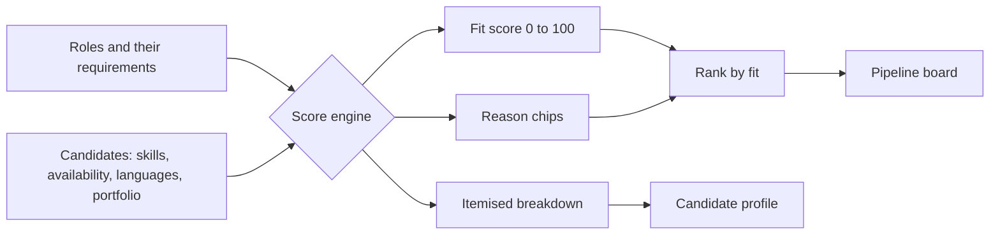

<picture>
  <source media="(prefers-color-scheme: dark)" srcset="./.github/assets/banner-dark.svg">
  <source media="(prefers-color-scheme: light)" srcset="./.github/assets/banner-light.svg">
  
</picture>

<p align="center">
  <b>A hiring console that ranks interns, volunteers and fresh graduates by what they can do,<br>and shows the reason behind every single point.</b>
</p>

<p align="center">
  <a href="#every-point-has-a-reason">See the score</a>
  &nbsp;·&nbsp;
  <a href="#proof-beats-a-cv">Skill tasks</a>
  &nbsp;·&nbsp;
  <a href="#run-it-in-60-seconds">Run it in 60 seconds</a>
</p>

<p align="center">
  
  
  
  
  
</p>

<br>

<picture>
  <source media="(prefers-color-scheme: dark)" srcset="./.github/assets/hero-dark.png">
  <source media="(prefers-color-scheme: light)" srcset="./.github/assets/hero-light.png">
  
</picture>

<br>

## 89 applications. One internship. Every CV says "quick learner."

Picture a recruiter in Doha at 11 pm, on application 52 of 89. Same courses. Same clubs. Same "team player." The student who could actually do the job looks exactly like the ones who can't.

And the students pay too. No experience means no job. No job means no experience.

CVs are blind to ability. **S-Talent isn't.**

<br>

## Meet S-Talent

**1. Rank.** One click puts every applicant in order of fit. No black box: the score is a sum of rules you can read.

**2. Explain.** Open any candidate and see the receipt. Every point, and exactly why it was given.

**3. Prove.** A candidate with no experience takes a short practical task in engineering, marketing, finance or design, instead of being filtered out by a CV.


<br>

## Every point has a reason

Most screening tools hide the score inside a model and ask recruiters to trust it. S-Talent shows its working.



**The same applicant always gets the same score.** It is built from four kinds of evidence, and each one is listed with its points:

- **Skills.** +10 for every required skill the candidate shows. Missing skills are listed too, at zero.
- **Availability.** +15 if they can start now, +10 if flexible.
- **Languages.** +10, but only when the role actually requires them.
- **A visible cap.** If the total passes 100, the cap appears as its own line.

Anything that is not about the job counts for nothing. A paid membership badge is displayed, and earns **zero** points.

That matters more every year. The EU AI Act classes hiring algorithms as high risk, and New York City already requires bias audits for automated hiring tools. A score you can read line by line is a score you can audit.

<sub>The whole engine is about 80 lines: <a href="./lib/data/mock-data.ts">lib/data/mock-data.ts</a></sub>

<br>

## Proof beats a CV

Every task is scored the same way the fit score is: by a written rubric that shows the points behind each check. No hidden grader.

<table>
  <tr>
    <td width="50%" valign="top">
      
      <br><b>Code that actually runs.</b> The engineering task executes the candidate's solution against real test cases, in the browser.
    </td>
    <td width="50%" valign="top">
      
      <br><b>Judgement, not keywords.</b> Split a 50,000 dollar budget across five channels and watch return, customers and cost per customer update live.
    </td>
  </tr>
  <tr>
    <td width="50%" valign="top">
      
      <br><b>An eye for detail.</b> Critique a checkout screen. A five-check rubric scores it and shows where every point came from.
    </td>
    <td width="50%" valign="top">
      
      <br><b>One pipeline.</b> Drag candidates from New to Hired across six stages, with conversion computed from real stage counts.
    </td>
  </tr>
</table>

<br>

## Under the hood



- **Deterministic by design.** No randomness anywhere in scoring. The breakdown is computed first and the score is its sum, so the two can never disagree.
- **Everything runs in the browser.** Next.js 16 App Router, React 19 and TypeScript, with Framer Motion for motion, dnd-kit for the pipeline and Recharts for insights.
- **14 screens in about 6,000 lines,** from the recruiter dashboard to four SkillProof tasks, built overnight.

<br>

## Run it in 60 seconds

```bash
git clone https://github.com/anasrustom/S-Talent.git
cd S-Talent
npm install
npm run dev
```

Open [localhost:3000](http://localhost:3000). No accounts, no database, no API keys.

<br>

## What's real, and what's next

- [x] Explainable fit score with an itemised breakdown for every application
- [x] Four SkillProof tasks, each scored by a visible rubric, with the engineering task running real tests
- [x] Six-stage drag and drop pipeline, with every dashboard and insight number computed from the data
- [ ] Backend, sign-in and real applicant data (today the app ships realistic demo data: 10 candidates, 6 roles)
- [ ] Let each recruiter set the weights per role
- [ ] Learn the weights from hiring outcomes, while keeping every point explainable

We built this in one night. It is a working prototype, not a product, and the list above is honest about the gap.

<br>

---

<p align="center">
  <sub>Built overnight at the <b>Snoonu Hackathon</b>, Doha, January 2026, by <a href="https://github.com/anasrustom">Anas Rustom</a> and team.<br>
  S-Talent is an independent hackathon project and is not an official Snoonu product. Snoonu's name and brand belong to Snoonu.</sub>
</p>
